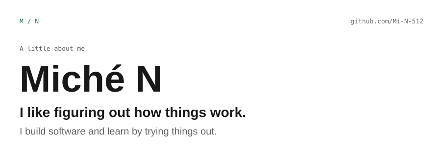
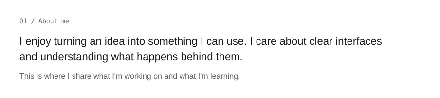
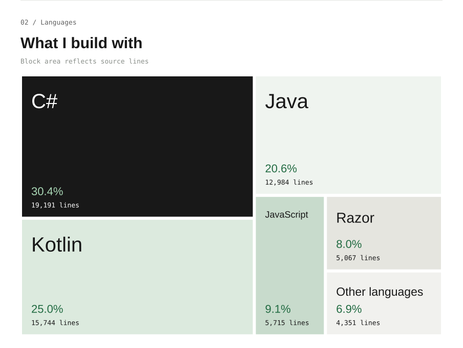
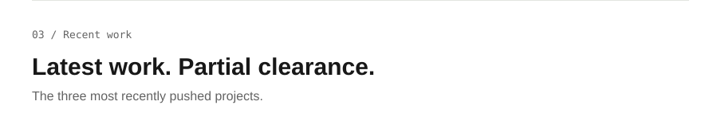
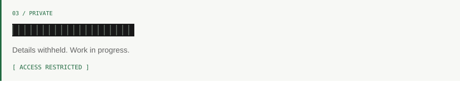
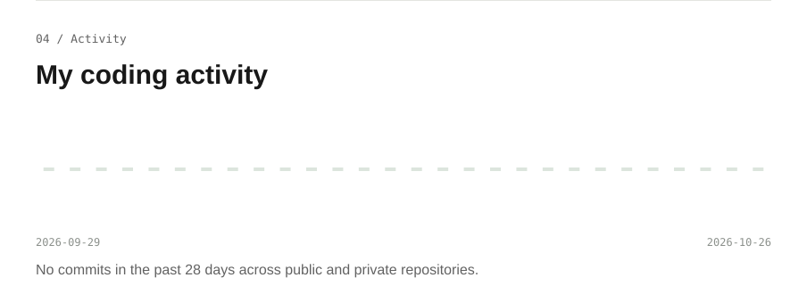
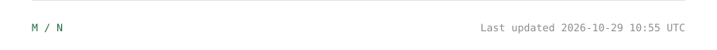

<picture><source media="(prefers-color-scheme: dark)" srcset="assets/dark/header.svg"></picture>
<picture><source media="(prefers-color-scheme: dark)" srcset="assets/dark/about.svg"></picture>
<picture><source media="(prefers-color-scheme: dark)" srcset="assets/dark/languages.svg"></picture>

View all languages at equal size

| Language | Source lines | Share |
| :--- | ---: | ---: |
| C# | 19,191 | 30.7% |
| Kotlin | 15,138 | 24.2% |
| Java | 12,984 | 20.8% |
| JavaScript | 5,715 | 9.2% |
| Razor | 5,067 | 8.1% |
| Bourne Shell | 1,491 | 2.4% |
| CSS | 1,093 | 1.8% |
| DOS Batch | 797 | 1.3% |
| TeX | 220 | 0.4% |
| XAML | 204 | 0.3% |
| Ruby | 115 | 0.2% |
| Fortran 77 | 96 | 0.2% |
| Prolog | 89 | 0.1% |
| Python | 72 | 0.1% |
| awk | 53 | 0.1% |
| HTML | 50 | 0.1% |
| SQL | 28 | 0.0% |
| Racket | 16 | 0.0% |
| JSX | 14 | 0.0% |
| PowerShell | 10 | 0.0% |

Source lines exclude blank lines and comments. Counts describe repository contents, not individual authorship. Generated and dependency directories are excluded. Includes accessible private repositories in aggregate. 1 oversized repositories excluded from line counts (100 MiB archive / 500 MiB expanded limit).

<picture><source media="(prefers-color-scheme: dark)" srcset="assets/dark/projects.svg"></picture>
<a href="https://github.com/Mi-N-512/Budget-Buddy"><picture><source media="(prefers-color-scheme: dark)" srcset="assets/dark/project-1.svg"></picture></a>
<picture><source media="(prefers-color-scheme: dark)" srcset="assets/dark/project-2.svg"></picture>
<picture><source media="(prefers-color-scheme: dark)" srcset="assets/dark/project-3.svg"></picture>
<picture><source media="(prefers-color-scheme: dark)" srcset="assets/dark/activity.svg"></picture>

View the daily breakdown

| Date (UTC) | Contributions |
| :--- | ---: |
| 2026-09-29 | 3 |
| 2026-09-30 | 5 |
| 2026-10-01 | 20 |
| 2026-10-02 | 3 |
| 2026-10-03 | 0 |
| 2026-10-04 | 7 |
| 2026-10-05 | 2 |
| 2026-10-06 | 2 |
| 2026-10-07 | 4 |
| 2026-10-08 | 0 |
| 2026-10-09 | 1 |
| 2026-10-10 | 0 |
| 2026-10-11 | 3 |
| 2026-10-12 | 6 |
| 2026-10-13 | 2 |
| 2026-10-14 | 4 |
| 2026-10-15 | 4 |
| 2026-10-16 | 1 |
| 2026-10-17 | 0 |
| 2026-10-18 | 0 |
| 2026-10-19 | 6 |
| 2026-10-20 | 2 |
| 2026-10-21 | 6 |
| 2026-10-22 | 2 |
| 2026-10-23 | 0 |
| 2026-10-24 | 0 |
| 2026-10-25 | 7 |
| 2026-10-26 | 5 |

Daily totals from GitHub's contribution calendar: commits, issues, pull requests, reviews and new repositories. Includes private contributions as daily totals only; no names or messages are published.

<picture><source media="(prefers-color-scheme: dark)" srcset="assets/dark/footer.svg"></picture>
